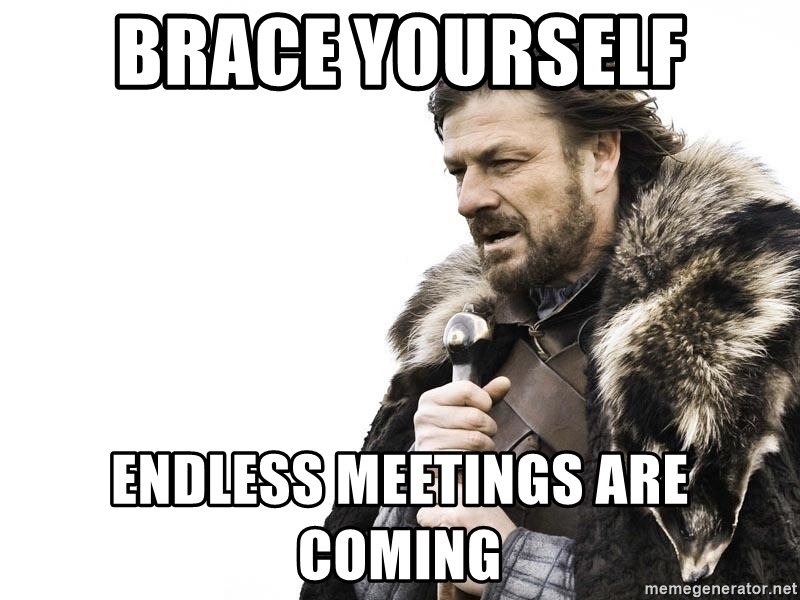
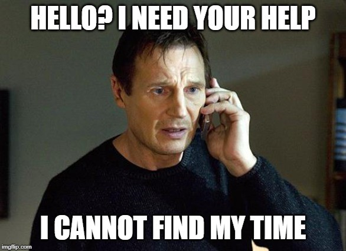

현재 제가 다니고 있는 회사의 Web Team(Front-End) 개발 팀장을 맡은지 어느덧 6개월이 되었습니다. 자의 반 타의 반이였지만, 어떻게든 버텨야된다는 마음 및 동료들의 적극적인 지원으로 여기까지 버틸 수 있었습니다. 이번 글에는 회고를 겸해 아래의 내용을 다뤄보려고 합니다.

- 팀장이 된 과정
- 지금 하고 있는 일들
- 느낀점

# 확실하게 말해주세요 하실꺼에요?

당시 저에게 팀장을 할껀지 안할껀지 물어보는 전임 팀장님의 느낌이 딱 이런 느낌이였습니다😓

때는 바야흐로 6개월 전, 전임 팀장님이 퇴사 하면서 저희 Web Team의 다음 팀장이 필요한 상황이 되었습니다. 저희 팀 내에서는 저를 포함한 아무도 하려고 하는 사람이 없었습니다. 이대로 가면 Senior Web 개발(Front-End) Leader분이 새롭게 오실때 까지 공석 혹은 대표님(!)이 겸임을 하셔야하는 상황이였습니다.

제 나름대로 머리를 굴리고 굴린 결과, 대표님이 겸직하시거나 공석으로 있는 것 보다는, 좀 이르지만 좋은 경험을 하는 셈치고 나라도 공석을 메꾸는게 좋을 것 같다는 결론에 이르렀습니다. _어차피 길어봐야 3개월 정도로 생각하고 그쯤 되면 제대로 Team Lead를 해줄 분이 들어오겠지~_ 라는 자기위로가 곁들어져 당시 팀장님과 면담을 가졌습니다. (물론 팀원들의 사전동의는 받은 상태였습니다.)

저 : "그.. 제가 해볼 수도 있을 것 같아요"

전임 팀장님 : "확실하게 말해주세요"

저 : "그.. 어 한 3개월 정도면 가능하지 않을까요?"

전임 팀장님 : "대표님한테 말씀드려하니까 확실하게 말해주세요 하실꺼에요?"

저 : "...할께요"

전임 팀장님 : "XX님 정도면 잘 하실 수 있을꺼에요~"

저 : "..."

그렇게 임시(저만 그렇게 생각하는) 팀장을 맡게 되었습니다.

# 팀장이 해야하는 일들

break 없는 무한 멘붕의 연속이였습니다. 하지만 이미 돌아가기에는 너무 먼 길을 와버렸어요

전임 팀장님의 2주간 인수 인계가 완료되고 본격적으로 팀장 업무를 수행하자 마자 밀려드는 업무에 곧바로 멘탈 붕괴가 찾아왔습니다. 어쩌면 이미 예견된 결과였습니다만, 어쩌겠습니까. 이미 돌아가기에는 너무 먼 길을 와버린걸요..😱 무튼 처음 팀장을 맡고 나서부터 현재까지 수행하고 있는 업무를 정리하니 다음과 같았습니다.

### 팀원 챙기기

- 오늘, 한주간, 한달간 상태 확인하기
- 팀원의 최근 이슈 확인하기
- 무단으로 야근하는 팀원 강퇴(?)

상태 확인이라고 하니 거창하지만, 가볍게 오늘 기분, 컨디션, 최근 이슈등을 파악해봅니다. 나쁜 부분이 있다면 원인이 무엇인지 확인하고 제가 해결 할 수 있는 부분은 바로 처리합니다. 그리고 다들 열정적이지만 특히 열정이 넘치시는분이 무단으로 야근하는 경우가 종종 보이는데, 조용히 빠른 퇴근을 권유해봅니다.

### 업무 분배

- 외부에서 오는 업무에 대한 적절한 방어
- 현재 진행중인 업무 파악
- 앞으로 진행될 업무 파악

저희 회사는 이제 막 폭발적으로 성장하고 있는 회사입니다. 많은 분들이 들어 온 만큼 아직 업무 프로세스에 익숙하지 않으신 분들이 프로세스를 거치지 않고 바로 업무 요청을 하시는 경우가 있는데, 적절하게 방어해내야합니다.. 다른 팀에서 업무 협조가 잘 이뤄지지 않는다고 불평할 수도 있겠지만 저는 우리팀이 먼저입니다😤

현재 진행중인 업무는 협업 툴인 Jira를 통해서 확인하고 있지만, 글로 다 파악할 수 없는 부분이 있기에 미팅이나 메신저로 파악하고 이슈가 있는지 체크해봅니다.

그리고 가장 중요한, 앞으로 진행될 업무에 대해서 체크하는 것 입니다. 저희 팀원끼리 앞으로 해야할 일에 대한 방향을 제시하고 문제 해결의 필요성에 대한 공감대를 형성하는것도 중요한 일이라고 생각하네요.

### 미팅.. Never End

- 스탠드업 미팅(daily)
- 팀 미팅(per week)
- 센터 미팅(per week)
- 코드 리뷰(per week)
- 스프린트 회고 미팅(per 2 week)
- 운영 미팅(per month)
- 기타 수시로 발생하는 미팅

미팅이 끝나지 않아..!

그때는 몰랐습니다. 팀장이 들어가야하는 미팅이 이렇게 많은건지..(다른 회사들은 어떤지 잘 모르겠습니다. 어떠신가요?) 제가 참여하는 미팅과 미팅에 대한 설명을 한번 적어보았습니다.

**스탠드업 미팅** : 매일 오전 11시에 가볍게 모여서 각자 1분씩 오늘 각자 진행할 업무를 공유합니다. 제가 팀장이 되고나서부터 얼마뒤 센터장님의 권유로 시작한 미팅입니다. 다른 회사는 스탠드업 미팅을 폐지하는 추세지만 5~6명 규모의 소규모 팀에는 적절한 미팅것 같습니다. 저는 여기서 저의 오늘 할일을 공유하고, 이슈가 있는 팀원을 파악하고 대응합니다.

**팀 미팅** : 매주 수요일마다 진행하는 저희 팀 미팅입니다. 한주간 있었던 이슈사항, 진행중인 업무를 Jira를 보면서 공유합니다. 특히 혼자서 해결하기 어려운 이슈는 모두가 공유하여 해결책을 주로 찾는 시간이네요.

개발**센터 미팅** : 매주 수요일마다 진행하는 개발 센터에 속해있는 Team Leader가 모여서 한주간 이슈사항에 대해 공유합니다.

**코드 리뷰** : 1주일동안 올라온 PR에 대해 다같이 리뷰하는 시간입니다. 코드 리뷰 시간이 자칫 서로에 대한 비난이 되지 않도록 진행에 항상 신경을 곤두세워야합니다.

**스프린트 회고 미팅** : 2주간 진행한 스프린트(저희는 2주단위로 스프린트를 진행하고 있어요)를 마무리하고 이번 스프린트에 대한 각자의 좋았던 점, 별로였던 점, 개선되어야할 점에 대해 공유하는 시간입니다.

**운영 미팅** : 위에서 언급된 미팅들과는 성격이 좀 다른 1달에 한번 정도 진행하는 미팅입니다. 개발과는 거리가 멀지만 회사에서 이뤄지는 결정사항이나 변경되는 운영정책들에 대해 공유하는 시간입니다.

## 나도.. 개발 만! 하고싶다..

참고로 저는 저희 회사의 주력 제품군 중 하나인 `Remote`의 웹 프론트 엔드 개발을 동료 개발자와 함께 담당하고 있습니다. 그럼 Team Lead 업무와 개발 업무를 어떻게 같이 하고 있냐고 물어보신다면, 그냥 하는 수 밖에 없습니다. 다만 고민끝에 최선을 다해 시간을 효율적으로 쓰는게 최선이라는 결론을 얻었습니다. (Team Lead가 Team Lead 업무 및 개발을 함께 하면서 겪는 어려움은 어딜 가나 비슷한 것 같습니다.) 그렇다면 한주에 평균 얼마의 시간을 사용할 수 있는지 한번 계산해봤습니다.

> 하루에 7시간을 일한다고 가정합니다.

### As Team Leader

- 스탠드업 미팅(10분)
- 팀 미팅(2시간)
- 개발 센터 미팅(2시간)
- 스프린트 회고 미팅(1시간 - 2시간이지만 2주에 한번이니 1시간으로 계산합니다)
- 코드 리뷰(2시간)
- 스프린트 회고 미팅(1시간 - 역시 2시간이지만 2주에 한번이니 1시간으로 계산합니다)
- 운영 미팅(30분 - 2시간이지만 한달에 한번이니 30분으로 계산합니다)
- 사내메신저로 오는 문의, 업무 요청 대응(2시간)
- Total : 10시간 40분

35시간 - 10시간 40분 = 24시간 20분

비록 24시간 20분이라는 한정된 시간이지만 나름 시간을 효율적으로 사용하고 있어서 제가 해야하는 개발 업무를 잘 소화해내고 있습니다. (혹시 시간 관리 꿀팁이 있다면 코멘트 부탁드려요 😭) 물론 개발 업무만 하고싶은 욕심은 그대로 이긴 합니다만.

# 느낀점

- 커뮤니케이션은 명확하게 : 팀원과 커뮤니케이션 할 때 명확한 의사 전달이 안되면, 받아들이는 팀원 입장에서는 혼란을 느껴 제대로된 의사가 전달이 안되었습니다.
- 사람은 각자의 대화 방법이 존재 : 똑같은 말을 하더라도 사람마다 받아들이는 방식이 각자 달랐습니다. 각자 살아온 배경, 경험, 성격이 다르기 때문이라고 생각하는데요. 개인적으로 대화할 때는 각자에게 맞는 대화 방법을 찾아야합니다.
- 너무 열심히 일하지 말아요 : 일에 대한 열정, 의지가 뛰어나신 분들이 의욕을 너무 불태우지 않게 조절해주어야합니다. 번아웃이 오지 않게요.
- 나부터 잘하기 : 고전적인 이야기지만 저부터 잘하지 않으면 같이 함께하고자 하는 사람들의 의지가 꺾이기 마련입니다. 뭔가 하고싶으면 저부터 잘하고 봐야합니다.

# 힘들지만.. 보람도 있어요

개발 3년차가 Team Leader를 하는게 결코 쉽지 않습니다. 힘든 순간들이 매번 찾아오지만 보람도 있습니다. 같은 팀원이 성장하는 모습을 보일 때, 과거에 해결하기 어려웠던 이슈를 다같이 함께 해결 방법을 찾아 해결 할 때, 보람을 느끼곤 합니다. 아마 이맛에 Team Lead를 하고 있지 않나 생각해봅니다.(저희 팀은 팀을 Lead 해주실분을 찾고있습니다!! 연락주세요 ㅜㅜ...)

### 큰 도움이 되었던 글도 공유해봅니다.

- 초보 개발 팀장의 1년 회고 - 좋은 팀장이 되기 위한 노력들([링크](https://zzsza.github.io/diary/2020/04/26/novice-leader-retrospect/))
